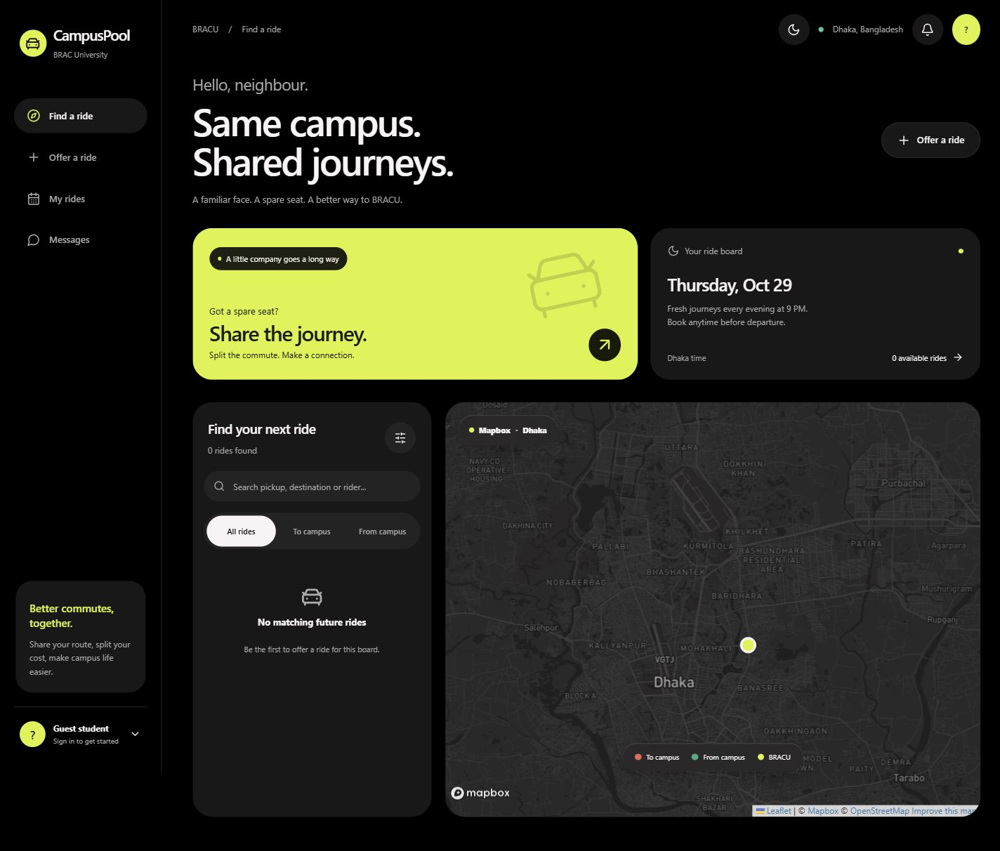

# choloCampus — BRACU Ride Sharing MVP

A product of [Nexasity](https://nexasity.pages.dev/).

A campus ride-sharing prototype for BRAC University students in Dhaka. Find or offer rides, request seats, and coordinate shared commutes through a responsive map-based interface.

**Topics:** `ride-sharing` · `carpooling` · `brac-university` · `campus` · `dhaka` · `react` · `vite` · `leaflet` · `capacitor` · `android`

## UI preview



*Earlier desktop UI preview; the screenshot uses the original CampusPool branding.*


## Current UI and maps

The running preview is React, with a reference-inspired black/lime interface,
system light/dark appearance, responsive floating navigation, and labeled ride markers.
The requested Flutter migration has not been implemented; Flutter is not installed
in the inspected environment.

Mapbox dark tiles are rendered through React Leaflet. Set `VITE_MAPBOX_TOKEN`
in `.env.local` using a public token and restart Vite. `.env.example` documents
the field; `.env.local` is ignored by Git. Public client tokens are visible in
the browser bundle: restrict the token to your local and deployed web origins
in your Mapbox account. Never place a secret Mapbox token here.

Without a token the map explicitly shows an OpenStreetMap preview. Mapbox tile
errors display a notice. Mapbox usage is subject to its account plan and quotas.

Design guidance used:
- https://github.com/anthropics/skills/blob/main/skills/frontend-design/SKILL.md
- https://github.com/bowen31337/apple-design/blob/main/SKILL.md

Apple-design CSS tokens are included in `src/apple-tokens.css`; the Mapbox logo
rule is from Mapbox GL JS v3.15.0's official stylesheet.

A runnable **front-end prototype** based on the uploaded BRAC University student ride-sharing plan.

## Run locally

Requires Node.js 20+.

On Windows PowerShell, use `npm.cmd install`, `npm.cmd run dev`, and
`npm.cmd run build` if PowerShell blocks `npm.ps1`.

Run the timezone and departure validation checks with:

```bash
node --test src/schedule.test.js
```

Google login accepts verified students and faculty at `g.bracu.ac.bd` and `bracu.ac.bd`. Set the Supabase URL and publishable key in `.env.local` as shown in `.env.example`; see [AUTH_SETUP.md](AUTH_SETUP.md) for Google provider setup. No secret/service-role keys belong in the frontend.

Rides, seat requests, messages and preferred destinations are stored in Supabase with row-level access rules and transactional seat acceptance. See [SHARED_DATA.md](SHARED_DATA.md) for details. The signed-out screen shows only the university login page.

```bash
npm install
npm run dev
```

Open the local address shown by Vite (typically http://localhost:5173).

To build for production hosting:

```bash
npm run build
```

## Included

- Responsive desktop/mobile ride-sharing user interface
- OpenStreetMap map via Leaflet, including red (to campus) and green (from campus) ride markers
- 9:00 PM Bangladesh-time rollover: from 9 PM to 8:59 PM the following day, the board displays that following day's offers
- Posting offers at any point in that period provided departure time is still in the future
- Vehicle type, pickup, destination, departure, seat count, and notes
- Request a seat, coordinate through private shared chat, accept/decline requests, and reduce seats on acceptance
- My Rides, university profile, and real shared offers
- Supabase storage and automatic refresh across signed-in devices

## Important limitations (not ready to deploy for real university use)

The shared backend and Google domain restrictions are implemented. Rides and messages refresh every five seconds while the app is visible. An internet connection is required; failed saves are not stored offline. Historical browser demo records are not automatically imported.

Before public launch, complete two-device Google login and booking tests, privacy/terms documentation, driver verification, reporting and moderation, notification delivery, and cancellation policies. Full address search and route matching remain future work.

## Daily rollover specification

- Example: Monday 9:00 PM → Tuesday 8:59 PM: board shows **Tuesday** rides.
- Students may post new Tuesday offers, request seats, and discuss fares throughout that window.
- A newly posted ride must depart later than the current Bangladesh local time.
- At Tuesday 9:00 PM, the board changes to **Wednesday** rides.
- Historic bookings remain accessible in My Rides and Messages.

## Tech stack

React 19, Vite 7, React Leaflet / Leaflet, Capacitor and Supabase Auth/Postgres. Client configuration uses public Mapbox and Supabase publishable keys.

Typography uses locally bundled Poppins (400, 500, 600, 700); its OFL license is in public/assets/Poppins-OFL.txt. UI icons use Flaticon Uicons Regular Rounded, with visible footer attribution as required by https://www.flaticon.com/uicons/get-started/.

## Latest test build

Find Ride now opens directly on the map with floating search and an expandable ride list. In Offer Ride, going to campus locks the destination to BRAC University; returning locks the pickup to BRAC University. The backend enforces these endpoints and validates departure times and seat counts.

The preferred destination picker supports searching the curated Dhaka locations or naming a map pin. It saves to the university account in Supabase and allows two saves per Bangladesh calendar day, resetting at midnight (separate from the 9 PM ride-board rollover). Optional nearby filtering uses a 3 km radius around the non-campus end of each ride. The daily limit is enforced on the server. The map has a current-location button; full address search, reverse geocoding and route directions are not implemented.

The new choloCampus logo is in public/brand/cholocampus-logo.png. The Android test build is artifacts/choloCampus-test.apk.

The default map screen now shows only a single floating Where to? search bar and compact navigation. Typing opens curated location suggestions and matching rides; selecting a location recenters the map. Filters and preferred destinations remain in the expandable search drawer. Tap the map, press Escape, or close results to return to the uncluttered map. Product and Flaticon credits are available in the menu and on other screens; Mapbox attribution stays on the map.

Appearance follows the system light/dark preference automatically, including live changes. The manual toggle is removed. Mapbox light-v11/dark-v11 tiles, form controls, browser chrome and Android splash/system bars follow the same preference.

The choloCampus wordmark uses the locally bundled Caveat handwriting font; the rest of the interface keeps Poppins. Caveat license: public/assets/Caveat-OFL.txt.
